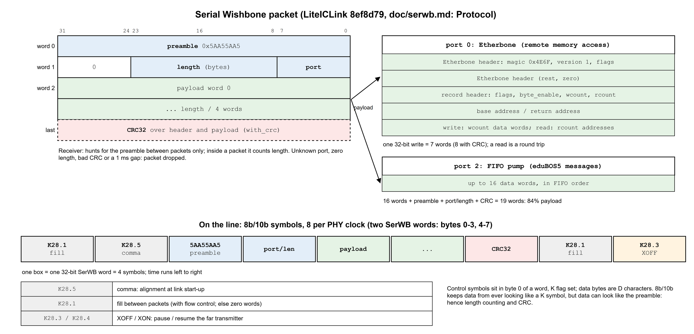
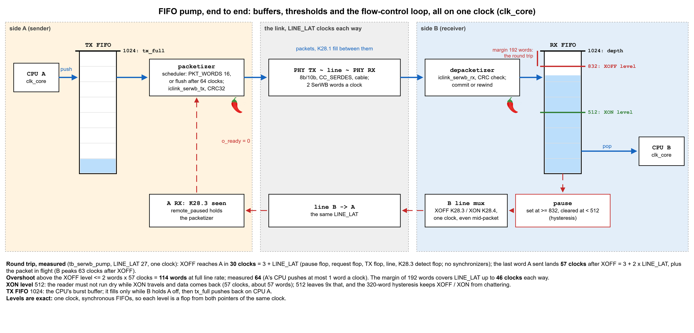
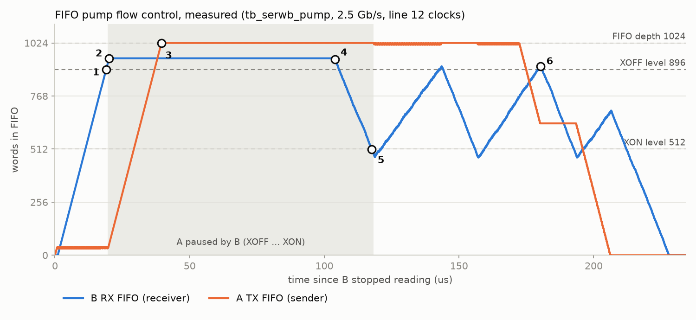
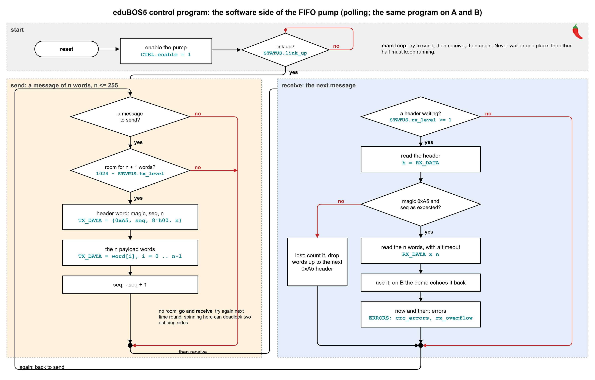

<!--
SPDX-FileCopyrightText: 2026 Chili.CHIPS

SPDX-License-Identifier: BSD-3-Clause
-->

# FIFO pump

A message link between the two eduBOS5 CPUs, ahead of remote memory access: each CPU pushes 32-bit words into a TX FIFO, the pump streams them to the other side, and the other CPU pops them from an RX FIFO. Both firmwares take part. It is the eduBOS5 <-> FIFO <-> link architecture planned for [openCologne-PCIE](https://github.com/chili-chips-ba/openCologne-PCIE/tree/main/2.rtl/6.soc), there with the PCIe PIPE in place of this PHY, so the FIFO side and its firmware carry over. Back to the [7.SerDes README](../README.md).

**Status:** the RTL ([`iclink_serwb_pump.sv`](../3.iclink-sv/1.hw/iclink_serwb_pump.sv), `iclink_serwb_fifo.sv`, `iclink_serwb_line.sv`) and its unit tests are done, at W = 2 and W = 4. It runs in the board top on setup 1 (`sim_top`, 2.5 and 5 Gb/s), after the PRBS test, and between two sides 200 ppm apart (`sim_link_ppm`, 2.5 Gb/s). Not yet: the CSRs, the firmware and the board.

## Standard SerWB, not a format of our own

LiteICLink's Serial Wishbone carries user streams on its packet ports, next to Etherbone: `SERWBCore.add_downstream_endpoint(port, ...)` / `add_upstream_endpoint(port, ...)`. Port 0 is Etherbone, port 1 is LiteICLink's SerIO by default. The pump uses **port 2**. Its words travel in ordinary SerWB packets, as specified in [LiteICLink `doc/serwb.md`, Protocol](https://github.com/enjoy-digital/liteiclink/blob/master/doc/serwb.md#protocol), implemented in [`serwb/packet.py`](https://github.com/enjoy-digital/liteiclink/blob/master/liteiclink/serwb/packet.py) (our [frame summary](serwb-protocol.md#serial-wishbone-frame)), so a LiteICLink SoC on an ECP5 (test setup 3) can send and receive them, and SerWB's CRC and flow control come with it. Etherbone, for remote memory access, comes later on port 0, on the same packet layer.

```
 eduBOS5 --CSR--> TX FIFO --> packetizer (port 2) --> PHY tx ~~line~~> PHY rx --> depacketizer --> RX FIFO --CSR--> eduBOS5
                 1024 x 32                                                                          1024 x 32
 '---------------------------------------- all on one clock, clk_core ----------------------------------------'
```

<p align="center"></p>

## How it works

**Packets.** Preamble, port/length, payload, CRC32. A packet goes out when `PKT_WORDS` words wait (default 16) or the TX FIFO has been idle for 64 clocks. The pump moves `W` SerWB words per line clock: **2** on the 64-bit PHY clock (bytes 0-3 and 4-7), or **4** on every other clock (`half_clk_strobe`), for 5 Gb/s. Either way it fills the line. Between packets: SerWB's K28.1 fill. While the link is down: comma words, K28.5 in byte lane 0 and K28.0 (no comma) in lane 4, which the far side's K filter drops. Payload share: 16 words 84%, 64 words 96%; the far receiver must accept the size (`crc_max_words` on LiteICLink).

**Speed.** eduBOS5 is the first source, for the demo; an FSM or DMA can fill the FIFO later. The FIFO decouples the two: the CPU fills it at its own pace, the pump drains it at line rate, so even eduBOS5 makes full-speed bursts of up to a FIFO (1024 words, 4 KB). Three performance levels, chosen by a parameter (`LINE_RATE`), from the same 100 MHz reference ([clocks and line rate](../3.iclink-sv/1.hw/README.md#clocks-and-line-rate)):

| Level | Line rate | Core clock (64-bit) | After 8b/10b | Payload, 16-word packets |
|---|---|---|---|---|
| low | 1.25 Gb/s | 15.625 MHz | 1.0 Gb/s | 0.84 Gb/s |
| **default** | **2.5 Gb/s** | 31.25 MHz | 2.0 Gb/s | 1.68 Gb/s |
| high | 5 Gb/s | 62.5 MHz | 4.0 Gb/s | 3.37 Gb/s |

At 5 Gb/s the pump moves W = 4 words on every other `clk_core`, enabled by `half_clk_strobe`, a flop that toggles; `iclink_serwb_line` turns its two PHY words a pump clock into one a clock and back, on the same clock. Below 5 Gb/s the strobe is 1. Its paths get 2 clocks, which needs multicycle paths in nextpnr: the 5 Gb/s build does not meet timing yet ([3.build](../3.iclink-sv/3.build/README.md#multicycle-paths-at-5-gbs)).

**Flow control.** SerWB's own, both sides on (`with_flow_control`): the receiver sends XOFF (K28.3) when its RX buffer is almost full, XON (K28.4) to resume. As in LiteICLink, the request takes the line for one clock, even in the middle of a packet, and is sent again every 1024 clocks. Our RX FIFO sends XOFF at `DEPTH - RT_CLKS·W` words (`RT_CLKS` = 96: 832 at W = 2, 640 at W = 4) and XON below 512. While a side asks for a pause, its depacketizer's timeout waits, so a long pause drops nothing. The numbers are worked out in [End2End Flow](#end2end-flow). On setup 1 the XOFF loops back to the same chip, which pauses itself.

**Clock correction.** Every 1024 clocks the line carries a burst of a fill word and 3 clock-correction words, even mid-packet, so that the far `CC_SERDES` RX buffer can take up the ppm between two boards: [clock correction](clock-correction.md). It costs 0.4% of the line.

**Errors.** CRC on (`with_crc`): a bad packet is dropped and counted in `crc_errors`. No retransmission; a dropped message is the firmware's to notice (a sequence number in the first word). The status counters (`crc_errors`, `drops`, `overflows`) stop at their maximum, 65535.

**Clocks.** One: `clk_core` runs the CPU, both FIFOs, the packetizer, the depacketizer and the line. The PHY's RX comes out on it too, through the `CC_SERDES` RX buffer. Two synchronous FIFOs of 1024 32-bit words: one word a clock on the CPU side, `W` on the line side. Each is `W` RAMs (two 512 x 32 at W = 2, even and odd words), so `W` neighbouring words always hit different RAMs (4 `CC_BRAM_20K` for the two FIFOs at W = 2). No pointer crosses a clock, so the FIFOs need no pointer handshakes, no reset bridging between sides, and no synchronizers on the flow-control state. Their levels are exact flops. At W = 4 the pump moves on every other clock of the same `clk_core`: still one clock, no crossing.

**RX FIFO as the packet buffer.** The depacketizer writes payload words as they arrive. A good CRC commits them (the read side sees the packet); a bad CRC, a timeout or an oversized header rewinds the write pointer to the last commit. LiteICLink's `CRCDepacketizer` stores each packet in its own `max_words` buffer first; here the RX FIFO is that buffer, so no block RAM is spent twice.

## CSRs (planned)

In SystemRDL, generated by PeakRDL, with the SoC. Each field maps to a pump port:

| Register | Fields | Pump ports |
|---|---|---|
| `TX_DATA` | write: push a word (ignored when full) | `tx_push`, `tx_data` |
| `RX_DATA` | read: pop a word | `rx_pop`, `rx_data` |
| `STATUS` | `tx_used`, `rx_avail`, `tx_full`, `rx_empty`, `link_up`, `remote_paused` (the far side paused us) | the same names; `link_up` from the PHY |
| `ERRORS` | `crc_errors`, `drops`, `overflows`: counts, stop at 65535 | the same names |
| `CTRL` | `tx_en`, `rx_en`, `tx_hold` (no new packet starts: the TX FIFO fills, then goes out at line rate) | the same names |

## Tests

Done:

1. **Unit, two pumps on the digital bus** (`sim_serwb_pump`, `sim_serwb_w4`): 6000 words each way, in order; flow control (the reader stops, XOFF arrives before the RX FIFO overflows, no word lost, XON resumes); a pause longer than the timeout drops nothing; a `tx_hold` burst at line rate.
2. **Interoperability, level 1:** the packetizer and depacketizer are bit-exact with LiteICLink's own `Packetizer` and `CRCDepacketizer`, CRC errors and drops included (`sim_serwb_tx`, `sim_serwb_rx`; [levels](serwb-protocol.md#interoperability-proof)).
3. **Board top, setup 1** (`sim_top`): a counter through the looped-back link, every word in order.
4. **Two boards, 200 ppm apart** (`sim_link_ppm`): every word in order both ways, kept in step by clock correction.

Planned:

1. A pump phase in the PHY testbenches (`tb_phy_oneway`, `tb_phy_twoway`), so their FSTs and WaveCrux sessions cover it.
2. **Interoperability, level 2:** LiteICLink's own SerWB test cases run against our RTL.
3. A flipped bit inside a packet on a real line: that packet dropped and counted in `crc_errors`.
4. With the eduBOS5 SoC: firmware on A sends a message, B echoes it. On setup 3, the ECP5 side runs LiteICLink with the same port 2.

## End2End Flow

How much buffer, where the thresholds sit, and how the levels move. Measured with `sim_serwb_pump` at W = 2: two pumps wired on the digital bus, a `LINE_LAT`-clock line between them each way: 31 clocks, 3 more than the PHY's 28 on the BFM (`sim_phy_oneway` prints it), to err on the slow side. One clock for both pumps and both CPUs, as on the chip.

<p align="center"></p>

**The round trip.** One clock and no synchronizers, so the loop is short. From B's RX FIFO reaching the XOFF level to A stopping takes 3 + `LINE_LAT` clocks: the pause flop, the request flop, the TX flop, the line, then the K28.3 detect flop on A. Words A sent before it stopped still land: another `LINE_LAT` clocks of them.

| | Formula | `LINE_LAT` 31 |
|---|---|---|
| XOFF reaches A | 3 + `LINE_LAT` clocks | 34 clocks, measured 34 |
| Last word lands in B | 3 + 2 x `LINE_LAT` clocks after XOFF, plus the packet in flight (its words commit at its CRC) | 65 clocks; first peak measured at 63 |
| Overshoot above XOFF, worst | W words x (3 + 2 x `LINE_LAT`) | 130 words |
| Overshoot, measured | | 64 words at the first peak (896), 71 at the highest of the whole run (903): A's CPU pushes at most 1 word a clock |
| Margin | `RT_CLKS`·W = 1024 - 832 = 192 words | covers `LINE_LAT` up to 46 clocks each way |

With the asynchronous FIFOs we had before, the same loop took 8 + `LINE_LAT` clocks to reach A: two 2-flop synchronizers more.

At W = 4 (`LINE_LAT` 31 line clocks, 5 Gb/s) the pump moves on every other clock and the XOFF level is 640: measured peak 751, 111 words above XOFF, against a 384-word margin.

`LINE_LAT` counts PHY TX, `CC_SERDES` with its RX buffer, the cable and PHY RX: on the BFM 28 clocks at every rate (0.9 us at 2.5 Gb/s); the test takes 31. The silicon's own latency and the cable are to be measured on the board; `RT_CLKS` sets the margin.

**Sizing rules.**

1. **RX FIFO, XOFF level:** depth minus the worst overshoot. One packet in progress (`MAX_WORDS` 16) is part of the level already, since the RX FIFO is the packet buffer.
2. **RX FIFO, XON level:** high enough that the reader does not run dry while XON travels and data comes back (3 + 2 x `LINE_LAT` = 65 clocks, about 65 words for a reader at 1 word a clock); low enough that XOFF and XON do not chatter. 512 gives 8 times the first and 320 words of hysteresis.
3. **TX FIFO:** the CPU's burst buffer. While the far side lets data through, the line drains it faster than the CPU fills it (2 words a clock against 1); it fills only while A is held off, and then `tx_full` pushes back on CPU A.
4. **Levels are exact.** One clock: each FIFO level is a flop, from both pointers of the same clock. A word becomes readable 3 clocks after it is written (the RAM write flop, then the commit pointer, so the RAM always holds what the reader may take).
5. **A LiteICLink peer** (setup 3) sends packets of at most 16 words and reacts to XOFF in its own clocks; 192 words is 3 us of line at 2.5 Gb/s, well above its pipeline.

<p align="center"></p>

**Fill and empty, as measured** (B's CPU stops reading, A's keeps pushing):

1. B's RX FIFO fills at 1 word a clock, A's CPU rate, and reaches 832: B sends XOFF.
2. It peaks at 896, 63 clocks later: 64 words were already on their way. A stopped after 34 clocks.
3. A's TX FIFO now fills from A's CPU and reaches 1024: A's CPU must wait (`tx_full`).
4. B reads again, at about 1 word a clock.
5. B drops below 512: XON. A resumes 34 clocks later and, at up to 2 words a clock, refills B faster than B reads.
6. B swings between about 450 and 900, XOFF and XON in turn, until A's TX FIFO is empty. Not one word lost, no overflow, no drop. The highest of these refill peaks is 903, the 71 words `sim_serwb_pump` prints.

Re-run, in `7.SerDes/3.iclink-sv/2.sim`: `make sim_serwb_pump`, then `python3 plot_pump_levels.py`. Each W writes its own `pump_levels_w<W>.csv`; the plot takes W = 2.

## eduBOS5 control program

The software side of the data flow, planned for the demo: one polling loop, the same on A and B, over the [CSRs](#csrs-planned) above.

<p align="center"></p>

**Messages.** A header word `{0xA5, seq, 8'h00, n}`, then `n` payload words (`n` <= 255). The pump does not know where a message starts or ends: it packs words into packets of 16, so a message may span two packets.

**Rules.**

1. **Never wait in one place.** A full TX FIFO means "receive now, send next time round". If both sides spin on a full TX FIFO while their RX FIFOs fill, neither ever reads: a polite deadlock, each side holding the door for the other.
2. **Check room before a message**, not before each word: `1024 - tx_used >= n + 1`, so a message goes into the FIFO whole.
3. **Read the payload with a timeout.** A dropped packet (bad CRC) takes words with it, and they never arrive.
4. **Detect losses by `seq`.** A wrong `seq` or a missing `0xA5` means a lost packet: count it and drop words up to the next header. There is no retransmission in the pump; resending is the program's choice.
5. **Look at `ERRORS` now and then:** `crc_errors` and `drops` count the dropped packets, `overflows` must stay 0 while flow control works.

On B the demo echoes each message back, so A can check every word it sent.

#### End-of-Document
