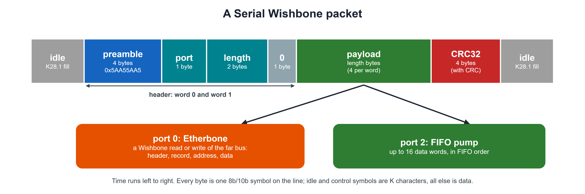

<!--
SPDX-FileCopyrightText: 2026 Chili.CHIPS

SPDX-License-Identifier: BSD-3-Clause
-->

# 7.SerDes hardware

The chip-to-chip link: LiteX's LiteICLink SerWB over our GateMate `CC_SERDES` PHY. See the [7.SerDes README](../../README.md).

## RTL coding rules

For all new openCologne RTL.

**LiteX code.** The C2C core (SerWB and the GateMate PHY) is SystemVerilog, hand-ported from LiteICLink, and follows the rules below. Only the thin Migen wrapper that hands it to LiteX is Python, in LiteX's own style.

IEEE 1800-2009 SystemVerilog:

- **Declare and size once:** widths, constants and types live in a `_pkg`; no module redeclares them.
- **Fewer, richer ports:** interfaces and struct-typed ports, not many scalars; group internal signals the same way.
- **Packages:** `import` right after the module name, no package prefix on every use.
- **Case:** signals and ports lower case, constants UPPER CASE (parameters, localparams, enum values, macros). Only hard-macro and primitive pins (`CC_SERDES`, `CC_PLL`, ...) keep vendor names.
- **Procedural blocks:** `always_ff` for flip-flops, `always_comb` for combinational logic, never plain `always`. `unique case` for parallel muxes whose items cover every value, `unique0 case` where no item may match, `priority case` for priority encoders; never plain `case`. A `unique case` has no `default`.

  | Keyword | Several items match | No item matches | Synthesis meaning |
  |---|---|---|---|
  | `unique` | violation | violation, unless there is a `default` | `parallel_case` + `full_case` |
  | `unique0` | violation | allowed, nothing happens | `parallel_case` only |
  | `priority` | first one wins | violation, unless there is a `default` | ordered (priority) logic |

- **`logic`, not `wire`:** every signal and port is `logic`, every `input`/`output` typed. Only an `inout` is a `wire`.
- **`initial` blocks:** not in RTL, except `$readmemh` of a memory image. Models and test benches may use them freely.
- **No `` `timescale `` in RTL:** the test bench sets it. RTL has no `#` delays.
- **No initial values on registers:** a register gets its value from the reset branch of its `always_ff`.
- **Arrays, not flat buses:** arrays of lanes or structs, no index arithmetic on flat buses.
- **`/*LINT:OK*/`:** marks an unused *output* pin of a hard macro, primitive or third-party core as reviewed: `.PIN (/*LINT:OK*/),  // reason`. Never on an input; unused inputs are tied off.
- **No-connects:** unused bits of a hard-macro or primitive output go to `NC_` signals, never read.
- **Lint:** fix findings at the root; waive only as a last resort, with a reason, in the waiver file. Don't mold legal, intended code around one tool's quirk: waive it instead.
- **Variants in one file:** a parameter selects the variant inside one module, never a copy of the module; `generate` branches are named.
- **Flopped controls:** a high-fanout control (load enable, mux select) comes from a flop, placed next to the logic it serves.
- **One signal per function:** no `x` plus `x_q` pairs.
- **Minimal logic:** leave out terms that do not change behaviour, and say why in a comment.
- **Assertions:** only under an `ifdef`; the RTL is never changed for them.
- **Clean diffs:** no blank-line or alignment changes beyond what `run-format.sh` makes; check `git diff` before a commit.
- **Models follow the RTL:** a model keeps the ports, names and structure of the RTL it replaces, as our SerDes BFM does for `CC_SERDES`.
- **Formatting:** `run-format.sh` (Verible): every body in `begin` ... `end`, alignment on, LF line endings, at most 100 columns. Run it last, after lint, before a commit; `run-format.sh --check` only lists unformatted files.

-----------
## Compared with LiteICLink

Upstream: LiteX `d2b47282a`, LiteICLink `8ef8d79` (2026-10-21), snapshot in [`../0.upstream`](../0.upstream).

| | LiteICLink (ECP5, Xilinx GTx PHYs) | This core (GateMate `CC_SERDES`) |
|---|---|---|
| Words per clock | 2 (20-bit SerDes word), or 4 (40-bit) | 8 (80-bit SerDes word) |
| User data per clock | 16 or 32 bits + 2 or 4 K flags | 64 bits + 8 K flags |
| Core clock at 2.5 Gb/s | 125 or 62.5 MHz | 31.25 MHz |
| TX order | 8b/10b encoder, then PRBS mux | PRBS mux, then 8b/10b encoder |
| PRBS on the line | raw bits | 8b/10b D characters |
| 8b/10b TX | fabric (LiteX `Encoder`) | fabric (`iclink_8b10b_enc`, bit-exact port) |
| 8b/10b RX | fabric (LiteX `Decoder`) + word aligner | inside `CC_SERDES`, with comma alignment |
| Encoder pipeline | 2 clocks | 1 input register + 2 clocks |
| Flops at the SerDes | as the PHY needs | one stage on every datapath and control port |

Why the differences:

- **RX in the hard macro.** With its 8b/10b off, `CC_SERDES` hands out only bits 7:0 of each symbol, so the fabric cannot decode. RX decoding and comma alignment stay in `CC_SERDES`.
- **PRBS through 8b/10b.** A raw PRBS would reach the fabric only as decoded bytes, so the PRBS travels as D characters and is checked after the decoder.
- **8 words per clock.** The `CC_SERDES` fabric interface is 64 bits + 8 K flags at line rate / 80. The encoder's running disparity runs through all 8 words in one clock, 2 to 4 times LiteICLink's chain. That chain is the TX critical path at 31.25 MHz; registering the encoder input took the PRBS mux out of it.

## Clocks and line rate

**Why 31.25 MHz.** The core clock is the line rate divided by the line bits per clock. We use the widest `CC_SERDES` fabric interface, 64 data bits (80 line bits after 8b/10b), so f_core = 2.5 Gb/s / 80 = 31.25 MHz (DS1001, eq. 2.5). That is 64 bits x 31.25 MHz = 2.0 Gb/s of payload, the whole line minus 8b/10b. The other widths need faster fabric:

| `CC_SERDES` datapath | Line bits per clock | Core clock at 2.5 Gb/s |
|---|---|---|
| 16 / 20-bit | 20 | 125 MHz |
| 32 / 40-bit | 40 | 62.5 MHz |
| **64 / 80-bit (this core)** | 80 | **31.25 MHz** |

Our TX path closes at about 33 MHz (the 8-word encoder chain); 62.5 or 125 MHz with fabric 8b/10b is out of reach on GateMate. Wide and slow is what fits.

**PLL setting.** The bring-up writes regfile `0x51` = `0x16FA` (`iclink_phy_pkg.sv`, `CFG_SEQ`):

| Field | Bits | Value | Means (DS1001 Tables 2.15, 2.17) |
|---|---|---|---|
| `PLL_FCNTRL` | [5:0] | 58 | M1 = 20 |
| `PLL_MAIN_DIVSEL` | [11:6] | 27 | N1 = 1, N2 = 5, N3 = 5 |
| `PLL_OUT_DIVSEL` | [13:12] | 1 | M3 = 2 |
| `TX_DATAPATH_SEL[1]` | parameter | 1 (64-bit) | M4 = 2 |

From the 100 MHz reference: oscillator 100 x N1·N2·N3 = 2500 MHz (its range is 1250-2500 MHz); bit rate clock f_BRC = 2500 / M3 = 1.25 GHz, both edges, 2.5 Gb/s; core clock f_DPC = f_BRC / (M1 · M4) = 1250 / 40 = 31.25 MHz.

**Other line rates.** The oscillator stays at 2500 MHz; M3 sets the rate:

| Line rate | M3 (`OUT_DIVSEL`) | f_BRC | Core clock, 64-bit | `0x51` |
|---|---|---|---|---|
| 1.25 Gb/s | 4 (`11`) | 625 MHz | 15.625 MHz | `0x36FA` |
| **2.5 Gb/s** | 2 (`01`) | 1.25 GHz | 31.25 MHz | `0x16FA` |
| 5 Gb/s | 1 (`00`) | 2.5 GHz | 62.5 MHz | `0x06FA` |

- **1.25 Gb/s:** the register value only; timing gets easier. Or the 32-bit path (M4 = 1) at 31.25 MHz with 4 words per clock (`PHY_NWORDS` = 4).
- **5 Gb/s:** 62.5 MHz is too fast for the fabric encoder. The way is `CC_SERDES`'s own TX 8b/10b (`TX_8B10B_EN_I`), leaving only flops and the PRBS mux in the fabric; plus the SI settings below and a board check (5 Gb/s is the chip's maximum).
- All three are planned as performance levels of the FIFO pump (parameter `LINE_RATE`, [spec](../../README.md#fifo-pump-spec-for-review)); 2.5 Gb/s is the default.
- The SerDes BFM may model 2.5 Gb/s only; to check before simulating other rates. Per-rate CDR settings: not given in DS1001.

## Signal-integrity settings

Today the bring-up writes the PLL only: every SI setting is at its default (no TX emphasis, no DFE adaptation, no termination calibration). Most influential first (our judgement, for short board and cable links at 2.5-5 Gb/s; DS1001 section 2.5):

| # | Setting | Registers | Effect | Default |
|---|---|---|---|---|
| 1 | TX swing | `TX_AMP` (unit current), `TX_BRANCH_EN_MAIN` (0-63 branches) | eye height at the receiver; too high adds crosstalk and power | 15, 63 |
| 2 | TX pre/post-emphasis (FFE) | `TX_SEL_PRE` / `TX_SEL_POST`, `TX_BRANCH_EN_PRE` / `_POST` (0-31) | boosts transitions against channel loss; the main lever at 5 Gb/s or on long cables | off |
| 3 | RX DFE, 3 taps | `RX_EN_EQA` (adaptation), `RX_TAPW`, `RX_TH_MON1/2`, `RX_AFE_OFFSET` | cancels inter-symbol interference | adaptation off |
| 4 | RX termination, common mode | `RX_CALIB_EN` (calibrate 100 ohm), `RX_RTERM_VCMSEL` (0.62-0.86 x VDDIO) | reflections; input common mode (AC coupling: set here; DC: set by the TX) | calibration off, 4 |
| 5 | RX CDR loop | `RX_CDR_CKP` / `CKI`, `RX_CDR_LOCK_CFG`, `RX_CDR_TRANS_TH` | jitter tolerance, lock time | `0xF8`, 0 |
| 6 | TX common mode | `TX_CM_RAISE`, `TX_DC_OFFSET`, `TX_CM_THRESHOLD_0/1` | matters with DC coupling | `TX_DC_OFFSET` 0 (DS1001: "set to 8") |
| 7 | Reference clock, polarity | `PLL_REF_RTERM`, `TX/RX_POLARITY_I` | reference jitter (spec 1 ps) goes straight to the PLL; polarity fixes swapped P/N | on, normal |

**Tuning.** PRBS with `rx_prbs_errors` as the error counter, and `CC_SERDES`'s eye measurement (DS1001 Tables 2.46, 2.47) for the margin; sweep in the order above. Worth adding to the bring-up regardless: `TX_DC_OFFSET` = 8, and termination calibration.

## Why Etherbone and the packetizer

They make the link memory-mapped: eduBOS5 on chip A loads or stores to an address window, and the access runs on chip B's bus with no software on B.

- **Etherbone** turns one Wishbone access (address, data, read or write, byte enables) into a record and runs it on the far bus; a read returns its data, so A's load just waits.
- **The packetizer** frames each record (preamble, port, length, optional CRC32), so the receiver finds its start, drops broken ones and resyncs after an error.

When B only needs to receive data, Etherbone is not needed, but the packetizer still is: it carries user streams on its other ports. The FIFO pump ([7.SerDes README](../../README.md#fifo-pump-spec-for-review)) moves words between the two CPUs on port 2, in standard SerWB packets, so it interoperates with LiteICLink.

## Serial Wishbone frame

The format of LiteICLink `8ef8d79`, which our port keeps so it interoperates. Not in RTL yet. Sources:

- the SerWB spec: [LiteICLink `doc/serwb.md`, Protocol](https://github.com/enjoy-digital/liteiclink/blob/master/doc/serwb.md#protocol), implemented in [`serwb/packet.py`](https://github.com/enjoy-digital/liteiclink/blob/master/liteiclink/serwb/packet.py); our copy: [`../0.upstream/liteiclink/doc/serwb.md`](../0.upstream/liteiclink/doc/serwb.md). LiteICLink added this document on 2026-10-21 (`175c81e`), with its SerWB review; before, the format was only in the code;
- Etherbone: CERN's [Etherbone core](https://ohwr.org/projects/etherbone-core), as implemented in LiteEth's [`frontend/etherbone.py`](https://github.com/enjoy-digital/liteeth/blob/master/liteeth/frontend/etherbone.py), which LiteICLink reuses.

At a glance:

In detail, word by word and on the line:

**Packet**, in 32-bit words:

| Word | Content |
|---|---|
| 0 | preamble `0x5AA55AA5` |
| 1 | `[7:0]` port, `[23:8]` payload length in bytes, `[31:24]` 0 |
| 2 .. | payload, length / 4 words |
| last | CRC32 over the header and payload, only with `with_crc` (both sides) |

The receiver hunts for the preamble, reads port and length, and forwards the payload to that port. Unknown ports are dropped; a packet that stops arriving is dropped after a 1 ms timeout; with CRC, a bad packet is dropped and counted in `crc_errors`.

**Port 0 carries Etherbone**, one record per packet, 32-bit addresses and data (CERN's Etherbone, as cut down in LiteICLink: no probing, no address spaces):

| Payload word | Content |
|---|---|
| 0 | Etherbone header: magic `0x4E6F`, version 1, flags `nr` / `pr` / `pf`, `addr_size`, `port_size` |
| 1 | Etherbone header, rest (zero) |
| 2 | record header: flags (`bca`, `rca`, `rff`, `cyc`, `wca`, `wff`), `byte_enable`, `wcount`, `rcount` |
| 3 | write: base address; read: return address |
| 4 .. | write: `wcount` data words; read: `rcount` addresses to read |

**One 32-bit write**, A to B: 7 words, 8 with CRC.

| Word | Value |
|---|---|
| 0 | `0x5AA55AA5` |
| 1 | port 0, length 20 bytes |
| 2, 3 | Etherbone header |
| 4 | record header, `wcount` = 1, `rcount` = 0 |
| 5 | address |
| 6 | data |
| (7) | CRC32 |

Writes are posted: acknowledged once sent. **A read** is a round trip: A sends a record with `rcount` = 1 (return address, then the address to read); B reads its bus and answers with a record with `wcount` = 1 (return address, then the data).

**On the line.** Each 32-bit word is 4 bytes, each an 8b/10b symbol (data as D characters). Between packets the line carries control symbols, K flag set, in byte 0 of a word:

| Symbol | Use |
|---|---|
| K28.5 | comma: alignment at link start-up |
| K28.1 | fill when there is nothing to send (with flow control; without it, zero words) |
| K28.3 / K28.4 | XOFF / XON: pause and resume the far transmitter (flow control, both sides) |

**On our PHY**, 8 symbols per clock: two SerWB words per 31.25 MHz clock, the first in bytes 0-3, the second in bytes 4-7, each K flag with its byte. LiteICLink's 4-symbol SerWB encoder is then replaced by the PHY's 8-symbol path (see the table above): interoperability is at the packet layer.

**Will it work with Lattice and others?** SerWB is not a standard; it is LiteICLink's own protocol, and LiteICLink is its only reference. It works with another vendor when the other side runs LiteICLink's SerWB core, and both sides agree below it:

- **8b/10b:** standard (IBM), the same code tables in LiteX and in `CC_SERDES`;
- **bit and byte order on the line, polarity:** set by each SerDes; to be measured on test setup 3 (ECP5);
- **framing and Etherbone:** identical by construction, when we port the core bit-exact and check it against LiteX's model, as for 8b/10b.

So it is proven only by test.

### Interoperability proof

Two references, for two jobs:

- **To read and learn:** this README's [Serial Wishbone frame](#serial-wishbone-frame), a readable spec of the format, with an at-a-glance picture and a word-by-word one, following LiteICLink's own [`doc/serwb.md`](https://github.com/enjoy-digital/liteiclink/blob/master/doc/serwb.md#protocol).
- **To prove interoperability:** LiteX's own SerWB code, not our reading of either document.

**The proof uses LiteX's own SerWB code.** LiteICLink's packetizer, depacketizer, CRC and Etherbone (Python / Migen) generate the traffic our RTL must produce, and check the traffic our RTL sends. An error in our understanding of the format then shows up as a mismatch against LiteX itself. Three levels, each with LiteX on the other side:

| Level | LiteX side (generator / checker) | Our side | Proves |
|---|---|---|---|
| 1. Vectors | LiteICLink `Packetizer` / `Depacketizer` (`serwb/packet.py`), run in Migen, write packet vectors, as `gen_8b10b_vectors.py` does for 8b/10b | our packetizer and depacketizer in Verilator | bit-exact packets: preamble, port, length, payload, CRC32 |
| 2. LiteICLink's tests | its own test cases (`test/test_serwb_packet.py`: loopback, CRC loopback, corrupted packet dropped, oversized packet dropped, zero length, timeout; `test_serwb_link.py`: Wishbone, byte enables, unknown port) | the same cases run against our RTL | same behaviour, error cases included |
| 3. Silicon | LiteICLink SoC on the ECP5 (test setup 3) | IC Link on the GateMate | the same over a real link, both directions |

The 8b/10b and PRBS ports already pass level 1 against LiteX's own models (`code_8b10b.py`, `prbs.py`), clock for clock. Levels 1 and 2 run in CI; level 3 on the bench.

**Can the payload contain `0x5AA55AA5`?** Yes. Nothing stops it: the payload is plain data. The receiver still keeps its place by counting, not by searching. It looks for the preamble only between packets; inside a packet it counts `length` bytes and ignores what they hold (`Depacketizer`, `serwb/packet.py`). A false start needs the receiver to lose count first, after a bit error, a dropped word or a reset. Then:

- a word in the payload that equals the preamble can start a false packet;
- the next word must still give a port the receiver knows and a non-zero length; otherwise it is dropped;
- **with CRC** (`with_crc`), the false packet fails its CRC32 (1 in 2^32 chance to pass), its length is bounded (`crc_max_words`), and it is dropped and counted;
- **without CRC**, the false packet can reach the bus. The receiver resyncs at the next real preamble, or after the 1 ms timeout.

Formats that must never mistake data for framing mark packet starts with an 8b/10b control symbol, which data cannot produce (PCIe uses STP and SDP). SerWB uses K symbols only between packets. For a robust link we use SerWB **with CRC**. A K-symbol start of packet would be safer still, but it would break compatibility with LiteICLink.

## Conversion process

LiteICLink is Python (Migen). We port it by hand, block by block:

1. Read the Migen module and its tests; pick the SV structure (packages, `always_ff`, one module per Migen class).
2. Write the SV to our [RTL coding rules](#rtl-coding-rules).
3. Generate test vectors from LiteX's own Python model ([`../2.sim/gen_8b10b_vectors.py`](../2.sim/gen_8b10b_vectors.py), [`gen_prbs_vectors.py`](../2.sim/gen_prbs_vectors.py)), and compare clock for clock in Verilator.
4. Lint, format and, for clean-ups, prove equivalence with [`../3.build`](../3.build) (`run-lint.sh`, `run-format.sh`, `run-leq.sh`).
5. When upstream moves, regenerate the vectors: unchanged vectors mean the port still matches.

Where LiteICLink's structure does not fit `CC_SERDES` (the PHY), we keep its interface and write new RTL.

#### End-of-Document
