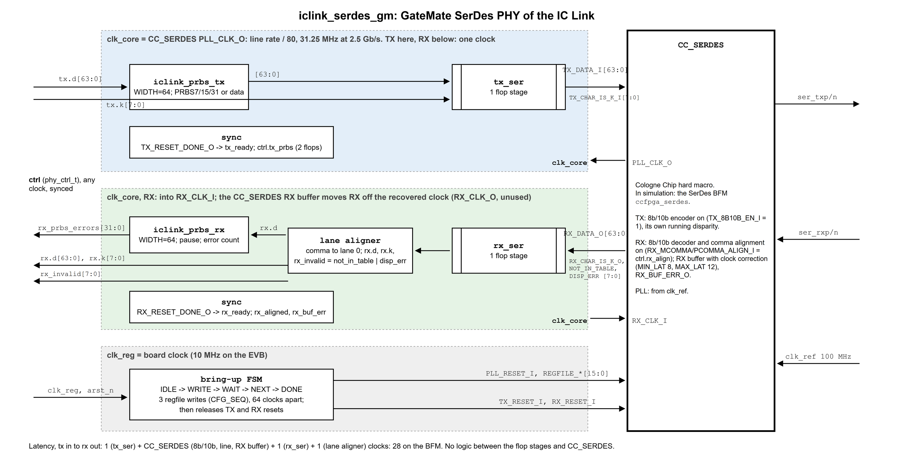

<!--
SPDX-FileCopyrightText: 2026 Chili.CHIPS

SPDX-License-Identifier: BSD-3-Clause
-->

# 7.SerDes hardware

The RTL of the chip-to-chip link: LiteX's LiteICLink SerWB over our GateMate `CC_SERDES` PHY, in SystemVerilog, to our [RTL coding rules](../../../RTL-CODING-RULES.md). Back to [3.iclink-sv](../README.md).

## RTL coding rules

Moved to the repo root: [RTL-CODING-RULES.md](../../../RTL-CODING-RULES.md).

## Modules

| File | What |
|---|---|
| `top.sv`, `top_pkg.sv` | EVB board top (test setup 1): reset, heartbeat, PRBS self-test, SerDes link test, FIFO pump test, LED |
| `iclink_serdes_gm.sv`, `iclink_phy_pkg.sv` | the GateMate SerDes PHY on `CC_SERDES`: bring-up, ready flags, lane aligner, one flop stage at the macro |
| `iclink_prbs_tx.sv`, `_rx.sv`, `_gen.sv`, `_chk.sv` | PRBS7/15/31 TX and RX, ported from LiteX's `prbs.py` |
| `iclink_serwb_pump.sv` | FIFO pump: CPU-to-CPU words on SerWB port 2, flow control, clock-correction bursts ([spec](../../0.doc/fifo-pump.md)) |
| `iclink_serwb_tx.sv`, `_rx.sv`, `iclink_serwb_pkg.sv` | SerWB packetizer and depacketizer with CRC32, ported from LiteICLink's `serwb/packet.py` ([protocol](../../0.doc/serwb-protocol.md)) |
| `iclink_serwb_fifo.sv` | synchronous FIFO of the pump; the RX FIFO is the packet buffer (commit, rewind) |
| `iclink_gearbox.sv` | 2:1 gearbox, for the pump at W = 4 on half the PHY clock (5 Gb/s) |
| `iclink_pkg.sv` | common types |
| [`eduBOS5/`](eduBOS5/README.md) | the RV32I CPU of the SoC, copied from openPCIE; not in the top yet |
| `top.filelist`, `serwb.filelist` | compile order, for the build, the sims and the QA scripts |

```
top
 |- iclink_serdes_gm          the PHY
 |   |- iclink_prbs_tx        (iclink_prbs_gen x3)
 |   |- iclink_prbs_rx        (iclink_prbs_chk x3)
 |   '- CC_SERDES             (ccfpga_serdes, the BFM, in simulation)
 |- iclink_prbs_tx / _rx      the fabric self-test, on the board clock
 '- iclink_serwb_pump         (2.5 Gb/s builds)
     |- iclink_serwb_fifo x2
     |- iclink_serwb_tx
     '- iclink_serwb_rx
```

## The PHY

LiteICLink's PHY interface (8 bytes + 8 K flags per clock each way, PRBS, ready, comma alignment) on `CC_SERDES`, 64-bit datapath. As built:

<p align="center">
  
</p>

- **TX:** `CC_SERDES` encodes 8b/10b: bytes on `TX_DATA_I`, K flags on `TX_CHAR_IS_K_I`, its own running disparity. LiteICLink encodes in the fabric; the line is the same.
- **RX:** the comma alignment and the 8b/10b decoder of `CC_SERDES`, then a lane aligner in the fabric. `RX_ALIGN_COMMA_WORD` = 1X aligns the comma to 32 bits only, so it lands in lane 0 or 4 (DS1001 Figure 2.41); the lane aligner moves a lane-4 comma to lane 0.
- **RX buffer:** moves RX from the recovered clock onto `clk_core`, and between two boards takes up the ppm by clock correction (`MIN_LAT` 8, `MAX_LAT` 12; the far pump sends the bursts: [clock correction](../../0.doc/clock-correction.md)). `rx_buf_err` flags an overflow or underflow.
- **Comma alignment:** `rx_align` stays on while commas come in, then goes off before data or PRBS. While it is on, `CC_SERDES` realigns on any comma off the word boundary (DS1001 Table 2.50), so a line error could misalign a running link. The board top turns it off after 16 aligned commas (`ALIGN_COMMAS_LOG2` in `top_pkg`) and on again when `rx_ready` drops; the PHY testbenches turn it off 32 clocks after alignment.
- **PRBS:** over the 64 payload bits, as D characters through 8b/10b; LiteICLink sends it raw on the line instead. Our checker counts the errors, as LiteX does.
- **Flops at the `CC_SERDES` boundary:** every TX input of `CC_SERDES` (data, K, resets, comma align, regfile) comes straight from a flop; every RX output (data, K, decode errors, aligned, buffer error, reset done) goes into a flop first, before any logic. One flop stage each way.
- **Clocks:** one, `clk_core` = `PLL_CLK_O`, line rate / 80, for TX and RX. `RX_CLK_O` (the recovered clock) is not used. The board clock (`clk_reg`) runs the bring-up: the regfile writes of Cologne Chip's PRBS loopback test (PLL rate, SerDes enable, PLL on), then TX and RX out of reset. One write more than theirs: `PLL_CFG0` with the PLL off first, since `CC_SERDES` takes its bits [9:1] only then, and bit 1 (`CONFIG_SEL`) is what makes the rate write count. Without it the PLL runs at its default rate, whatever `PLL_CFG1` says (vendor model; caught by the SerDes BFM).
- **Resets:** `tx_ready` and `rx_ready` are flops on `clk_core`, low until the SerDes is up. They reset what runs on `clk_core` downstream (the PRBS TX, the lane aligner, the PRBS checker; in the top, the link tests and the pump), so a lost link restarts it.
- **Latency,** TX data in to RX data out: 1 (TX flops) + `CC_SERDES` (encoder, line, decoder, RX buffer) + 1 (RX flops) + 1 (lane aligner) clocks: 28 clocks on the BFM, at every line rate. `sim_phy_oneway` prints it.

A fabric decoder would also work: with the decoder off, bits 8 and 9 come out on `RX_CHAR_IS_K_O` and `RX_DISP_ERR_O` (DS1001 Figure 2.39).

**Found in LiteX:** `PRBSRX`'s `pause` does nothing. `~with_errors_saturation` is plain Python, and `~False` is `-1`, which widens the Migen expression so that `~self.pause` is never 0. With `pause=1` it still counts every error. Our SV pauses ([litex#2686](https://github.com/enjoy-digital/litex/issues/2686)).

## Compared with LiteICLink

Upstream: LiteX `d2b47282a`, LiteICLink `8ef8d79` (2026-10-21), snapshot in [`../0.upstream`](../0.upstream).

| | LiteICLink (ECP5, Xilinx GTx PHYs) | This core (GateMate `CC_SERDES`) |
|---|---|---|
| Words per clock | 2 (20-bit SerDes word), or 4 (40-bit) | 8 (80-bit SerDes word) |
| User data per clock | 16 or 32 bits + 2 or 4 K flags | 64 bits + 8 K flags |
| Core clock at 2.5 Gb/s | 125 or 62.5 MHz | 31.25 MHz |
| TX order | 8b/10b encoder, then PRBS mux | PRBS mux, then 8b/10b encoder |
| PRBS on the line | raw bits | 8b/10b D characters |
| 8b/10b TX | fabric (LiteX `Encoder`) | inside `CC_SERDES` |
| 8b/10b RX | fabric (LiteX `Decoder`) + word aligner | inside `CC_SERDES`, with comma alignment |
| Encoder pipeline | 2 clocks | none in the fabric |
| Flops at the SerDes | as the PHY needs | one stage on every datapath and control port |
| Clock compensation | none | RX buffer clock correction, bursts from the pump |

Why the differences:

- **8b/10b in the hard macro, both ways.** `CC_SERDES` encodes TX and decodes RX, with the comma alignment: no fabric, no fabric pipeline. The line is the same standard 8b/10b, so a LiteICLink peer that encodes in its fabric (ECP5, setup 3) sees no difference. LiteICLink encodes in the fabric because its ECP5 and Xilinx PHYs do. Our fabric port of LiteX's encoder and decoder (`2.sim/iclink_8b10b_enc.sv`, `_dec.sv`, bit-exact) stays in simulation only, as the reference.
- **Why not in the fabric.** The `CC_SERDES` fabric interface is 64 bits + 8 K flags at line rate / 80. A fabric encoder's running disparity runs through all 8 words in one clock, 2 to 4 times LiteICLink's chain. That chain was the critical path at 31.25 MHz, and out of reach at 62.5 MHz ([timing results](../3.build/README.md#timing-results)).
- **PRBS through 8b/10b.** With the decoder in `CC_SERDES`, a raw PRBS would reach the fabric only as decoded bytes, so the PRBS travels as D characters and is checked after the decoder.

## Clocks and line rate

**Why 31.25 MHz.** The core clock is the line rate divided by the line bits per clock. We use the widest `CC_SERDES` fabric interface, 64 data bits (80 line bits after 8b/10b), so f_core = 2.5 Gb/s / 80 = 31.25 MHz (DS1001, eq. 2.5). That is 64 bits x 31.25 MHz = 2.0 Gb/s of payload, the whole line minus 8b/10b. The other widths need faster fabric:

| `CC_SERDES` datapath | Line bits per clock | Core clock at 2.5 Gb/s |
|---|---|---|
| 16 / 20-bit | 20 | 125 MHz |
| 32 / 40-bit | 40 | 62.5 MHz |
| **64 / 80-bit (this core)** | 80 | **31.25 MHz** |

Wide and slow is what fits GateMate: the board top closes at 38 MHz against 31.25 at 2.5 Gb/s ([timing results](../3.build/README.md#timing-results)).

**PLL setting.** The bring-up writes regfile `0x51` = `0x16FA` (`iclink_phy_pkg.sv`, `CFG_SEQ`):

| Field | Bits | Value | Means (DS1001 Tables 2.15, 2.17) |
|---|---|---|---|
| `PLL_FCNTRL` | [5:0] | 58 | M1 = 20 |
| `PLL_MAIN_DIVSEL` | [11:6] | 27 | N1 = 1, N2 = 5, N3 = 5 |
| `PLL_OUT_DIVSEL` | [13:12] | 1 | M3 = 2 |
| `TX_DATAPATH_SEL[1]` | parameter | 1 (64-bit) | M4 = 2 |

From the 100 MHz reference: oscillator 100 x N1·N2·N3 = 2500 MHz (its range is 1250-2500 MHz); bit rate clock f_BRC = 2500 / M3 = 1.25 GHz, both edges, 2.5 Gb/s; core clock f_DPC = f_BRC / (M1 · M4) = 1250 / 40 = 31.25 MHz.

**Other line rates** (parameter `LINE_RATE`, Mb/s). The oscillator stays at 2500 MHz; M3 sets the rate:

| Line rate | M3 (`OUT_DIVSEL`) | f_BRC | Core clock, 64-bit | `0x51` |
|---|---|---|---|---|
| 1.25 Gb/s | 4 (`11`) | 625 MHz | 15.625 MHz | `0x36FA` |
| **2.5 Gb/s** | 2 (`01`) | 1.25 GHz | 31.25 MHz | `0x16FA` |
| 5 Gb/s | 1 (`00`) | 2.5 GHz | 62.5 MHz | `0x06FA` |

- **1.25 Gb/s:** the register value only; timing gets easier. Or the 32-bit path (M4 = 1) at 31.25 MHz with 4 words per clock (`PHY_NWORDS` = 4), which would need a lane-aligner change: it supports 8 words only.
- **5 Gb/s:** `CC_SERDES` encodes and decodes 8b/10b, leaving only flops, the lane aligner and the PRBS mux (a constant XOR matrix) in the fabric, and the PHY meets timing at 62.5 MHz. The FIFO pump at 5 Gb/s needs half `clk_core` for W = 4, not in the top yet. Still to do: the SI settings below and a board check (5 Gb/s is the chip's maximum).
- All three run in simulation (`sim_phy_rates`), and are the FIFO pump's performance levels ([FIFO pump](../../0.doc/fifo-pump.md#how-it-works)); 2.5 Gb/s is the default. Per-rate CDR settings: not given in DS1001.

## Signal-integrity settings

Today the bring-up writes the PLL only: every SI setting is at its default (no TX emphasis, no DFE adaptation, no termination calibration). Most influential first (our judgement, for short board and cable links at 2.5-5 Gb/s; DS1001 section 2.5):

| # | Setting | Registers | Effect | Default |
|---|---|---|---|---|
| 1 | TX swing | `TX_AMP` (unit current), `TX_BRANCH_EN_MAIN` (0-63 branches) | eye height at the receiver; too high adds crosstalk and power | 15, 63 |
| 2 | TX pre/post-emphasis (FFE) | `TX_SEL_PRE` / `TX_SEL_POST`, `TX_BRANCH_EN_PRE` / `_POST` (0-31) | boosts transitions against channel loss; the main lever at 5 Gb/s or on long cables | off |
| 3 | RX DFE, 3 taps | `RX_EN_EQA` (adaptation), `RX_TAPW`, `RX_TH_MON1/2`, `RX_AFE_OFFSET` | cancels inter-symbol interference | adaptation off |
| 4 | RX termination, common mode | `RX_CALIB_EN` (calibrate 100 ohm), `RX_RTERM_VCMSEL` (0.62-0.86 x VDDIO) | reflections; input common mode (AC coupling: set here; DC: set by the TX) | calibration off, 4 |
| 5 | RX CDR loop | `RX_CDR_CKP` / `CKI`, `RX_CDR_LOCK_CFG`, `RX_CDR_TRANS_TH` | jitter tolerance, lock time | `0xF8`, 0 |
| 6 | TX common mode | `TX_CM_RAISE`, `TX_DC_OFFSET`, `TX_CM_THRESHOLD_0/1` | matters with DC coupling | `TX_DC_OFFSET` 0 (DS1001: "set to 8") |
| 7 | Reference clock, polarity | `PLL_REF_RTERM`, `TX/RX_POLARITY_I` | reference jitter (spec 1 ps) goes straight to the PLL; polarity fixes swapped P/N | on, normal |

**Tuning.** PRBS with `rx_prbs_errors` as the error counter, and `CC_SERDES`'s eye measurement (DS1001 Tables 2.46, 2.47) for the margin; sweep in the order above. Worth adding to the bring-up regardless: `TX_DC_OFFSET` = 8, and termination calibration.

## Conversion process

LiteICLink is Python (Migen). We port it by hand, block by block:

1. Read the Migen module and its tests; pick the SV structure (packages, `always_ff`, one module per Migen class).
2. Write the SV to our [RTL coding rules](../../../RTL-CODING-RULES.md).
3. Generate test vectors from LiteX's own Python model ([`gen_8b10b_vectors.py`](../2.sim/gen_8b10b_vectors.py), [`gen_prbs_vectors.py`](../2.sim/gen_prbs_vectors.py), [`gen_serwb_vectors.py`](../2.sim/gen_serwb_vectors.py), [`gen_serwb_rx_vectors.py`](../2.sim/gen_serwb_rx_vectors.py)), and compare clock for clock in Verilator.
4. Lint, format and, for clean-ups, prove equivalence with [`../3.build`](../3.build/README.md#rtl-quality-assurance) (`run-lint.sh`, `run-format.sh`, `run-leq.sh`).
5. When upstream moves, regenerate the vectors: unchanged vectors mean the port still matches.

Where LiteICLink's structure does not fit `CC_SERDES` (the PHY), we keep its interface and write new RTL.

#### End-of-Document
