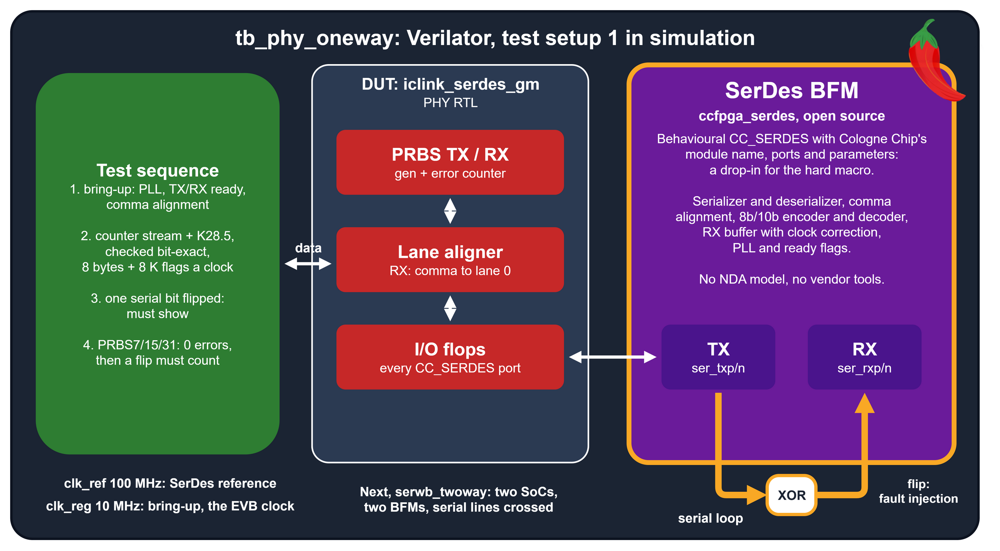
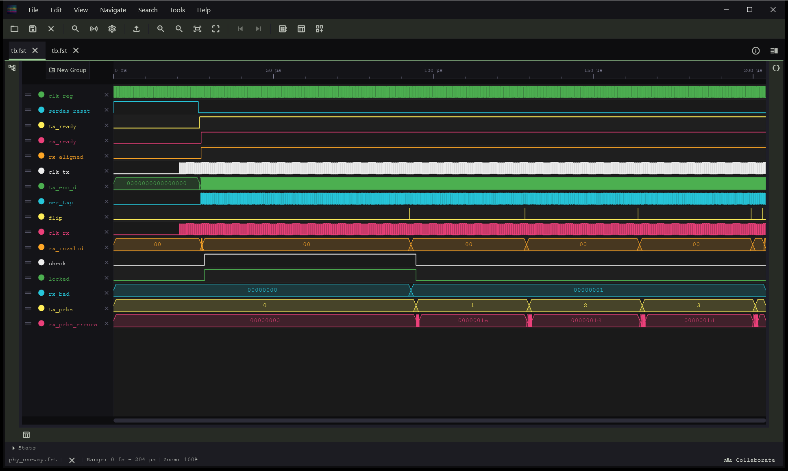
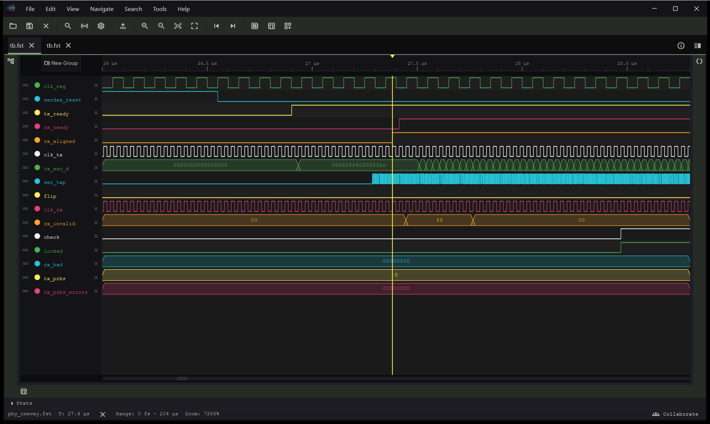
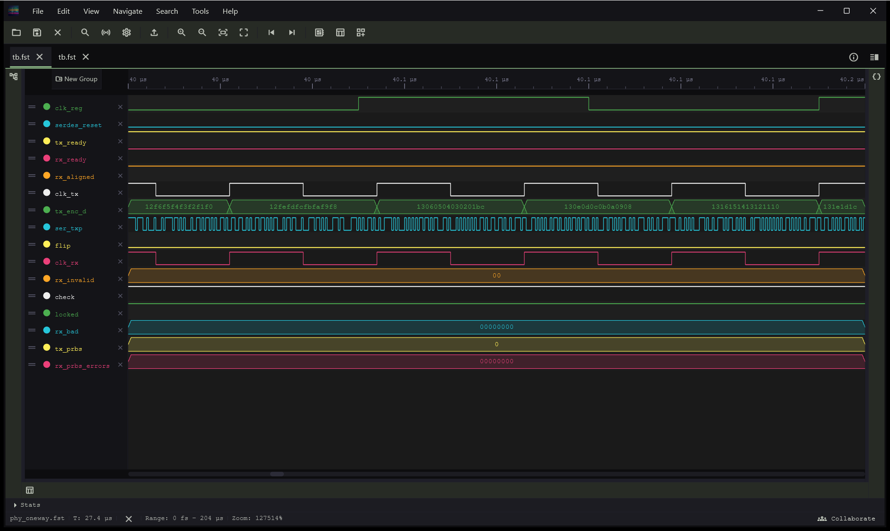
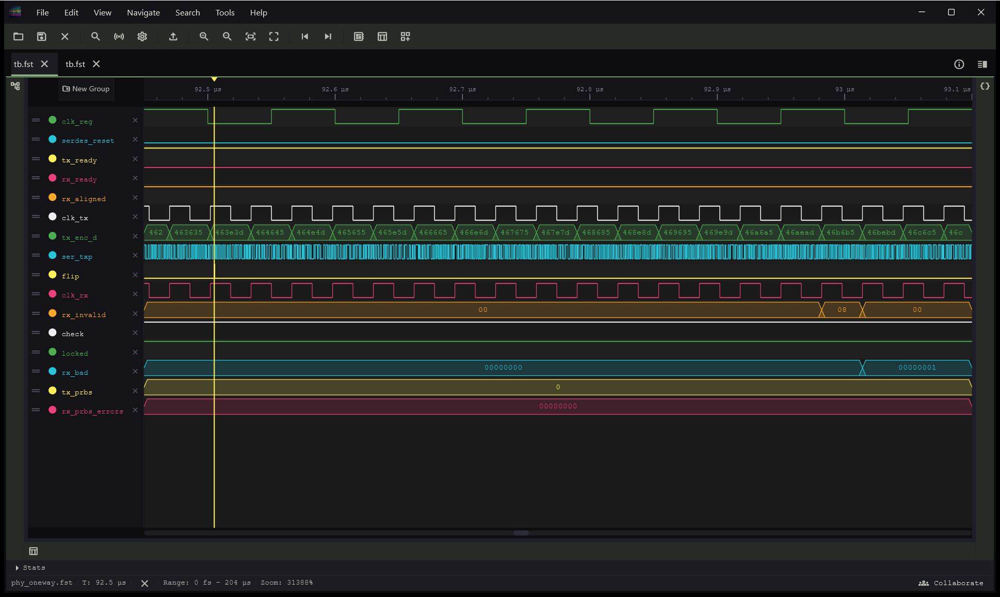
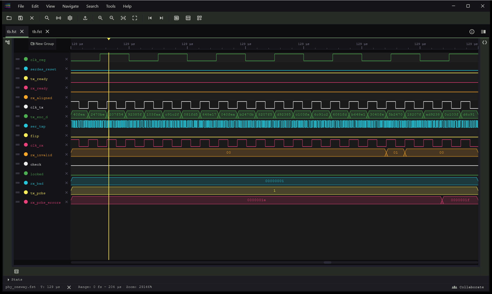

<!--
SPDX-FileCopyrightText: 2026 Chili.CHIPS

SPDX-License-Identifier: BSD-3-Clause
-->

# Simulation

Unit, PHY, board-top and two-board tests of the IC Link, in Verilator (and Icarus for the BFM). Each test passes or fails on its own. Back to [3.iclink-sv](../README.md).

```
make -C 7.SerDes/3.iclink-sv/2.sim          # every test below, from the repo root; mostly compile time
make -C 7.SerDes/3.iclink-sv/2.sim sim_top  # one test
```

Needs Verilator 5 (`--binary --timing`; we use 5.052) and Icarus Verilog 13. Only for `make vectors`: python3 with LiteX and LiteICLink. Only for the pump plot: matplotlib.

The SerDes in simulation is our open-source SerDes BFM, [`1.sim-model`](../../1.sim-model/README.md): a behavioural model of `CC_SERDES` with the vendor model's module name, ports and parameters, checked against it with 0 divergences. Verilator runs our RTL with the BFM in place of the hard macro, so no co-simulation (VProc) is needed. Once the eduBOS5 SoC is in, its RTL will run the test firmware the same way.

<p align="center">
  
</p>

## Tests

| Test | Checks |
|---|---|
| `sim_8b10b` | the reference SV 8b/10b (simulation only) against LiteX's own `code_8b10b.py`, bit for bit; round trip; running disparity |
| `sim_prbs` | the SV PRBS7/15/31 TX and RX against LiteX's own `prbs.py`, clock for clock; pause |
| `sim_phy_oneway` | mirrors setup 1. The GateMate SerDes PHY on the SerDes BFM, TX looped to RX: alignment (then `rx_align` off), data bit-exact, PRBS7/15/31 error-free, a flipped line bit seen, no RX buffer error; prints the latency |
| `sim_phy_twoway` | mirrors setup 2, PHY only. Two PHYs, lines crossed: data both ways bit-exact; PRBS15 one way and PRBS31 the other at once; a flip on one line is seen on that side only |
| `sim_serwb_tx` | the SerWB packetizer (FIFO pump, 2 words per clock) against LiteICLink's own `Packetizer(with_crc=True)`: 200 random packets, 2291 words bit for bit, with input gaps and line stalls; preamble look-alikes in the payload |
| `sim_serwb_rx` | the SerWB depacketizer (2 words per clock) against LiteICLink's own `CRCDepacketizer`: the same 259 packets forwarded, 43 CRC errors and 98 drops counted, from a stream with flipped payload and CRC bits, 0-word and oversized packets, corrupted headers, lost preambles and garbage; words in random slots with gaps; then a timeout drop |
| `sim_serwb_pump` | the FIFO pump, two sides on the digital bus (SerDes out of the loop), one clock for both pumps and both CPUs: 6000 words each way at once, in order; then B stops reading: XOFF, A stops, A's TX FIFO fills, B reads again, XON; no word lost, no overflow ([End2End Flow](../../0.doc/fifo-pump.md#end2end-flow)); a pause longer than the depacketizer's timeout drops nothing; then a `tx_hold` burst of 1024 words at line rate |
| `sim_serwb_w4` | the three SerWB tests at 4 words per clock (5 Gb/s), through the gearboxes |
| `sim_top` | the board top's self-tests, SerDes link and FIFO pump: a clean run (PRBS7, then the pump's counter, every word in order), then a flipped line bit must latch the error and turn the LED off |
| `sim_link_ppm` | mirrors setup 2 with the FIFO pump: two sides, each a PHY on its own BFM and a pump, lines crossed, the references 200 ppm apart (`PPM=`). 100,000 clocks of a counter each way: every word in order, no CRC error, drop, invalid symbol or RX buffer error, and the BFMs must have inserted and removed clock-correction words. Then the same without the pumps' bursts (`NO_CLKCOR`), which must fail ([clock correction](../../0.doc/clock-correction.md)) |
| `sim_modes` | `tb_modes`, one BFM looped back, 38 runs, about 1 min. The three `CDR_MODEL`s against each other at 2.5 Gb/s, 9 cases: 16-bit (comma in byte lane 0, 1), 32-bit (0, 1, 3), 64-bit (0, 3, 5, 7); data bit-exact; latency within 4 UI of ACCURATE (NONE +0.5 UI, FAST +0.5 to 2.5 UI: it knows a bit only at the next line edge). Then, in each mode, PRBS7 and PRBS31 with forced errors; 5 ms at 3 Gb/s in NONE and FAST (no drift off the time grid); the random RX word phase with `ALIGN_COMMA_WORD` = 11, seeds 1 to 3. Every run also checks the decode table against `dec8b10b()` (all 1024 symbols), the comma defaults, register readback and buffer errors. `tb_modes` takes `+cfg1=HEX`, `+run_us=N`, `+prbs=SEL` |
| `sim_icarus` | `tb_modes` in Icarus, each `CDR_MODEL`, data bit-exact, 15 runs, about 12 s: 16-bit (comma in byte lane 1), 32-bit (3), 32-bit with `ALIGN_COMMA_WORD` = 01 (even lane), 64-bit (0), and 64-bit with `ALIGN_COMMA_WORD` = 11 (lane 0 or 4). It keeps the BFM Icarus-clean: Verilator takes a name used before its declaration, even with `-Wall`; Icarus and the LRM don't |
| `sim_phy_rates` | not in `all`: both PHY tests at 1250, 2500 and 5000 Mb/s |
| `serwb_twoway` | planned; mirrors setup 2: two eduBOS5 SoCs, two BFMs, lines crossed. eduBOS5 A writes then reads back B's RAM and a B CSR (PeakRDL); the link recovers after one side is reset; the CRC test below |

Which test mirrors which board setup: [test setups](../../0.doc/test-setups.md).

**Planned: SerDes in the loop, or out.** The same SerWB tests run twice, once through the PHY, the 8b/10b, the BFM and the serial line (the full path: line errors, alignment), once with the two sides wired on the 64-bit + 8 K digital bus of `CC_SERDES` (the packet layer alone: fast, no line model). Both must see the same words; the run times show what the line model costs.

## Settings

Set them on the `make` line, e.g. `make -C 7.SerDes/3.iclink-sv/2.sim sim_phy_oneway CDR_MODEL=FAST SEED=3`, from the repo root.

| Setting | Default | Tests | What it does |
|---|---|---|---|
| `CDR_MODEL` | `NONE` | PHY, top, `sim_link_ppm` | The BFM mode: `NONE` (words beside the pins, fastest), `FAST` (bits from line edges), `ACCURATE` (a sampler every UI and a CDR loop) |
| `SEED` | none | PHY, top | The seed of the random RX word phase (below), passed as `+verilator+seed+N`. None: Verilator's fixed seed, the same run each time. `0`: a new random seed each run. Any other: that seed, repeatable |
| `RANDOM_PHASE` | random | PHY, top, `sim_link_ppm` | `0`: no random RX word phase, the comma always in byte lane 0 |
| `LINE_RATE` | `2500` | PHY | Mb/s: `1250`, `2500` or `5000` |
| `WAVES` | `0` | PHY | `1`: write an FST waveform, for WaveCrux, named by the options above ([waves](#waves)) |
| `SERWB_W` | `2` | SerWB | SerWB words per clock: `2` or `4` |
| `PPM` | `200` | `sim_link_ppm` | How far apart the two references are |
| `MODES_TOL_NS` | `1.6` | `sim_modes` | How far a mode's latency may be from ACCURATE's |

The BFM's `ALIGN_COMMA_WORD` is `CC_SERDES`'s `RX_ALIGN_COMMA_WORD`. A "byte lane" is one byte of the datapath word: lanes 0 to 7 at 64 bits.

**Random RX word phase.** On the silicon the RX word counter starts wherever it starts. With `RX_ALIGN_COMMA_WORD` = 1X the comma then lands in byte lane 0 or 4, a coin toss at each link-up (DS1001 Figure 2.41). The BFM does the same, from the seed. So a lane-0 assumption fails in simulation, before it can fail on the board. Try a few seeds: `for s in 1 2 3 4; do make -C 7.SerDes/3.iclink-sv/2.sim sim_phy_oneway SEED=$s; done`. `RANDOM_PHASE=0` turns it off. `sim_modes` turns it off for its comma-lane sweep, and runs it random in 3 more runs.

**BFM settings.** `CDR_MODEL` picks one of three levels of line and receiver model; the `BHV_*` settings tune the BFM. All of them, every vendor parameter it models, its speed and its check against the vendor model: [model README](../../1.sim-model/README.md).

Verilator is the reference simulator. The BFM also runs in Icarus Verilog, and `sim_icarus` keeps it so. Testbenches may use SystemVerilog that Icarus lacks, such as arrays of queues and queues of structs. Icarus can fly on, but shouldn't clip our wings.

## Negative tests

Every test that passes on a clean link also has to fail on a broken one. The testbenches break the serial line on purpose:

1. **Flip one bit** on the line for one UI (0.4 ns), in the middle of a word, through an XOR between TX and RX. In `NONE` the line is quiet, so the flip is a glitch on the pins, and the BFM inverts the bits it covers: the test runs in every `CDR_MODEL`.
2. **Data:** the receiver must see it, as an invalid 8b/10b symbol or a wrong word, and `rx_bad` must count it. In `phy_twoway` only the side whose line was hit may count.
3. **PRBS:** `rx_prbs_errors` must go up. With `pause` set, the same flip must not count.
4. **Board top:** a flipped line bit must latch the error and turn off the LED.
5. **Clock correction:** `sim_link_ppm` without its bursts must fail.

**CRC (planned, with `serwb_twoway`).** LiteICLink's Serial Wishbone can add a CRC32 to every packet (`with_crc=True`, both sides). The receiver drops a packet with a bad CRC and counts it in `crc_errors`. The test: eduBOS5 A writes a known value to B, a bit on the A->B line flips inside that packet, then A reads it back. Pass: the corrupted write is not applied, `crc_errors` on B is 1, and the next write and read go through. The same flip with the CRC off shows why it is needed: the access is corrupted silently whenever the flip still gives a valid 8b/10b symbol.

## Waves

`make -C 7.SerDes/3.iclink-sv/2.sim sim_phy_oneway WAVES=1 CDR_MODEL=FAST SEED=1` (or `sim_phy_twoway`) writes an FST next to the testbenches, named by the run's options: `phy_oneway.<CDR_MODEL>.<LINE_RATE>.s<SEED>[.rp<RANDOM_PHASE>].fst`, e.g. `phy_oneway.FAST.2500.s1.fst` (`s-`: no `SEED`, Verilator's fixed default; `s0`: a new seed each run, so not repeatable). Each run keeps its own file; the FSTs in this folder are in git. [`waves.vlt`](waves.vlt) traces only what the sessions show (no BFM insides, no PRBS generators and checkers), so a run is about 1.5 MB, not 9. `FAST` or `ACCURATE` puts bits on the line: in `NONE` it is quiet, and the serial decoder below has nothing to decode.

The sessions [`tb_phy.ONEWAY.wavecrux`](tb_phy.ONEWAY.wavecrux) and [`tb_phy.TWOWAY.wavecrux`](tb_phy.TWOWAY.wavecrux) open `phy_oneway.FAST.2500.s1.fst` and `phy_twoway.FAST.2500.s1.fst` in [WaveCrux](https://wavecrux.app): both in git, so no sim run is needed.

One session per test setup, with everything that setup needs: bring-up (clocks, reset, bring-up FSM, ready flags), TX data and the serial line, the flip, the received line with the serial decoder, RX data and errors, the checker, and PRBS. The one-way session has one PHY; the two-way session has both sides, labelled `a.` and `b.`. When Serial Wishbone is in, the two-way testbench and this same session gain the Wishbone bus of each eduBOS5 SoC (WaveCrux's built-in Wishbone decoder: a write on A, then the access arriving on B) and the Serial Wishbone packets.

The pictures below were taken on 2026-10-21, before the PHY moved to one clock and to the 8b/10b of `CC_SERDES`: two clocks (`clk_tx`, `clk_rx`) where the sessions now show `clk_core`, and the fabric encoder's output (`tx_enc_d`), now gone. Fresh screenshots are on the to-do list; the waves themselves are current.

The whole `phy_oneway` run, about 200 us: bring-up, the data stream with `check`, then PRBS7, 15 and 31, and the deliberate bit flips (`flip`).

<p align="center"></p>

Bring-up: the bring-up FSM releases the SerDes resets, TX is ready, the comma alignment locks, RX is ready (`rx_invalid` reads ff for a few clocks, until the first words arrive); then the checker locks on the data stream.

<p align="center"></p>

Data: one 64-bit word per 32 ns clock, 80 bits on the 2.5 Gb/s line (`ser_txp`). The word ending in `bc` carries the K28.5 comma in lane 0.

<p align="center"></p>

A deliberate bit flip (cursor). Through the BFM's receiver and the decoder, lane 3 reports an invalid symbol (`rx_invalid` = 08) and `rx_bad` counts the word.

<p align="center"></p>

The same during PRBS7: `rx_prbs_errors` counts the flip.

<p align="center"></p>

`phy_twoway`: a flip on the A->B line. Rows are A's, then B's. Only B sees it: B's `rx_invalid` and `rx_bad` go up; A's stay 0.

<p align="center">B seen by B only" src="images/wavecrux-twoway-flip-ab.png"></p>

### Decoders

[`tb_phy.TWOWAY.wavecrux`](tb_phy.TWOWAY.wavecrux) binds Ferrite's `ferrite.pcie_serial` decoder ([wavecrux-decoders](https://github.com/Ferrite-Engineering/wavecrux-decoders), PCIe plugin) to the received line of each side (`b.ser_rxp`, `a.ser_rxp`), with `rate` = `gen1` (2.5 GT/s, our line rate) and `scrambling` = `off`. It recovers the bits, locks on K28.5 commas and decodes 8b/10b. It flags `8b/10b code error` and `Disparity error` at the flipped bit. Its PCIe layer (ordered sets, packets) does not apply to IC Link traffic; use the symbol view. The plugin has to be installed in WaveCrux.

## Files

| File | What |
|---|---|
| `tb_*.sv` | the testbenches, one per test above |
| `iclink_8b10b_pkg.sv`, `_enc.sv`, `_dec.sv` | the LiteX 8b/10b, ported bit-exact: the reference for LiteX interoperability (on the chip `CC_SERDES` encodes and decodes) |
| `gen_*_vectors.py`, `vectors/` | the vector generators, run on LiteX's own code, and their committed output |
| `plot_pump_levels.py` | the End2End Flow chart, from `sim_serwb_pump` |
| `rtl.vlt`, `sim-model.vlt`, `waves.vlt` | Verilator config: waivers for the RTL in its packages and for the BFM; what `WAVES=1` traces |
| `phy_*.fst` | waves, named by the run options; the sessions open the `FAST.2500.s1` pair |
| `tb_phy.*.wavecrux`, `images/` | the WaveCrux sessions and their pictures |

#### End-of-Document
