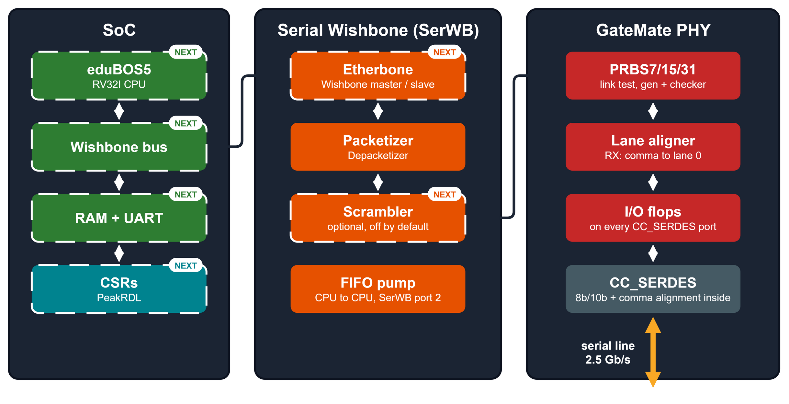
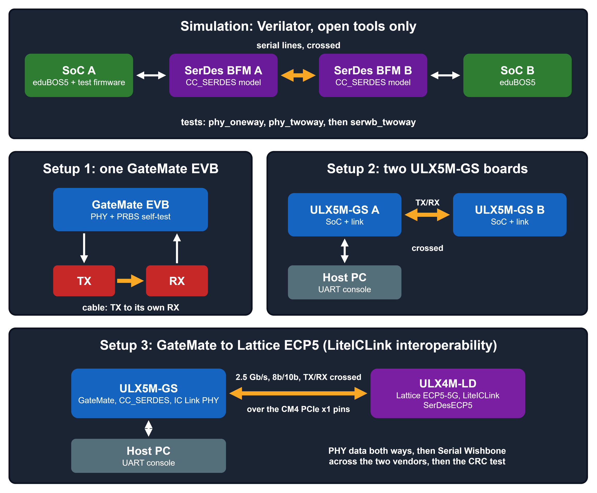
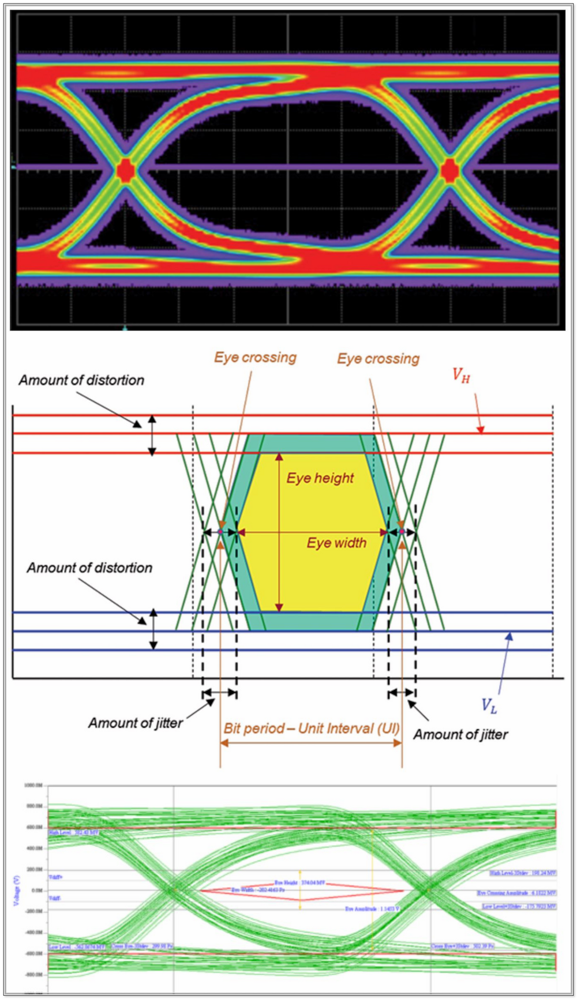

# SerDes App for GateMate

Design a high-speed serial, **memory-mapped Chip-to-Chip (C2C) Interconnect**. The goal of such IP is to set the stage for creating compute clusters and Hyper Cubes made of GateMate FPGAs, all physically interconnected with SerDes, with this C2C on top of it, serving as logical and transport layer.

## Plan of Record
Having thoroughly studied all options, the developers presented them in a project meeting on _July 11, 2025_, where team unanimously decided for the GateMate Chip2Chip SerDes:
- not to mimic the semi-proprietary _Xilinx/AMD Aurora_
- not to be based on _BerkeleyLab ChitChat_ 
- not to be based on _MesaBusProtocol_
- not to invent _our own scheme_ (which was the original plan of Chili.CHIPS*ba developers)
- but rather to port `LiteX IC Link`, thus honoring Cologne Chip guidance and strong preference **<== WINNER!**

The _IC Link_ brings a ready CPU interface and full LiteX integration, so Cologne Chip customers get it quickly, with little code. That makes it the C2C link Cologne Chip benefits from most for their SerDes.

Given that GateMate proprietary (aka "legacy") PnR is rather unreliable and insensitive to timing constraints, while the new opensource PnR (Project Peppercorn) has already saved the day for our WP9-[BetrustedSOC](https://github.com/chili-chips-ba/openCologne/tree/main/9.BetrustedSOC), the _C2C SerDes_ will be delivered solely and exclusively for the _nextpnr_ ([build](3.iclink-sv/3.build/README.md)).

## Where to start

Start with the standalone [SerDes loopback test](2.prbs-loopback/README.md), to get used to the hardware platform, SerDes settings, cabling and work with RF-class signaling in general. Then go to [3.iclink-sv](3.iclink-sv/README.md): the IC Link in SystemVerilog, with simulation and build.

| Folder | What | Status |
|---|---|---|
| [0.doc](0.doc) | diagrams, and the design notes below | |
| [1.sim-model](1.sim-model/README.md) | SerDes BFM: open-source simulation model of `CC_SERDES`; shared with openCologne-PCIE | done |
| [2.prbs-loopback](2.prbs-loopback) | standalone SerDes loopback test | works |
| [3.iclink-sv](3.iclink-sv/README.md) | the IC Link in SystemVerilog: our reference example, with the full QA flow | WIP |
| [9.liteiclink-migen](9.liteiclink-migen/README.md) | the earlier LiteICLink port in Python (Migen): GateMate PHY `serdes_gm.py`, LiteX target, demo firmware | archived prototype, does not build |

Design notes, in `0.doc`:

| Note | What |
|---|---|
| [FIFO pump](0.doc/fifo-pump.md) | the CPU-to-CPU message link: packets, flow control, End2End Flow with measured levels, the planned CSRs and firmware |
| [Clock correction](0.doc/clock-correction.md) | what the `CC_SERDES` RX buffer can and cannot do between two boards, what we did, what it means for PCIe |
| [Serial Wishbone protocol](0.doc/serwb-protocol.md) | the frame, Etherbone, the interoperability proof, preamble look-alikes, SerWB against PCIe |
| [Test setups](0.doc/test-setups.md) | the three hardware setups, GateMate to Lattice ECP5 |

## IC Link in SystemVerilog

We build on LiteX's [LiteICLink](https://github.com/enjoy-digital/liteiclink) rather than a new protocol. Its **Serial Wishbone (SerWB)** is a Wishbone bridge over a serial link: a bus master on one chip reads and writes memory and CSRs on the other. Upstream LiteICLink has transceiver PHYs for Xilinx (GTP, GTX, GTH, GTY) and Lattice ECP5, but none for GateMate.

LiteICLink is Python (Migen). We hand-port it to **SystemVerilog**, to our [RTL coding rules](../RTL-CODING-RULES.md), so it goes through our full QA flow: lint, Verible, LEQ ([3.build](3.iclink-sv/3.build/README.md#rtl-quality-assurance)). The protocol stays LiteICLink's, so it interoperates with it. LiteX takes it in as an external core, through a thin Migen wrapper ([4.litex](3.iclink-sv/4.litex/README.md)):

| Layer | What | From |
|---|---|---|
| C2C bus | SerWB master/slave, Wishbone over the link | LiteICLink, ported to SV |
| Packet, scrambler | SerWB datapath | LiteICLink, ported to SV |
| PHY | **on GateMate's `CC_SERDES` transceiver**: 8b10b, comma alignment, reset/lock sequence | **new**, SV, from the `serdes_gm.py` prototype |
| LiteX integration | Migen wrapper for the SV core | new, offered to LiteX |
| SoC | one per chip: [eduBOS5](https://github.com/chili-chips-ba/openPCIE/tree/main/2.rtl/0.common.opensource/src/CPU.eduBOS5) RV32I, RAM, UART; two eduBOS5 instances talk to each other over the link | eduBOS5 from openPCIE |
| CSRs | register map in SystemRDL, RTL and C headers generated by [PeakRDL](https://peakrdl.readthedocs.io), not LiteX's CSR generator | PeakRDL |

The SoC needs no LiteX, so neither does the core. LiteX users take only the SV core, through the wrapper.

**Design goals.**
- **An enabler, not the end goal.** The link serves the design around it: compute clusters, a CPU, an application. It must stay small and leave most of the FPGA, and its four global clocks, to that design. Area counts as much as speed.
- **The SerDes hard macro, used to the full.** Whatever `CC_SERDES` can do, it does, and the fabric doesn't: the 8b/10b encoder and decoder, comma alignment, the RX buffer that moves RX onto our clock, and RX clock correction between two boards. In the fabric: PRBS, a lane aligner and one flop stage at the macro. The Lattice reference, LiteICLink on ECP5, encodes and decodes 8b/10b in the FPGA fabric. On GateMate that fabric encoder chained its running disparity through 8 words a clock and was our critical path; in the hard macro it costs no fabric and no timing.
- **One clock, 100% synchronous** (done for the PHY and the [FIFO pump](0.doc/fifo-pump.md)). TX, RX, the FIFOs and the CPU all run on one clock, `clk_core`: `PLL_CLK_O`, line rate / 80, from the SerDes PLL. `RX_CLK_I` takes it too, and the `CC_SERDES` RX buffer moves RX from the recovered clock onto it. The board clock runs only the PHY bring-up, and in the EVB top its self-test, heartbeat and LED. At 5 Gb/s the pump moves on every other `clk_core` (`half_clk_strobe`), still on the one clock. On ULX5M-GS the SerDes reference has its own oscillator, so a CC_PLL from the board clock would drift against it. CC_SERDES's TX buffer takes up phase only; RX clock correction takes up the ppm between the two boards ([what it can and cannot do](0.doc/clock-correction.md)). No async FIFO and no clock-domain crossing in the fabric. Both ends are alike: no clock master or slave.

## Design internals and status

One GateMate. Solid boxes are done; dashed ones, tagged NEXT, come next.

  

| Block | RTL | From | Status |
|---|---|---|---|
| CPU, RAM, UART | eduBOS5 SoC; the CPU in [`1.hw/eduBOS5`](3.iclink-sv/1.hw/eduBOS5/README.md) | openPCIE | the CPU RTL copied from openPCIE (`54c5409`); the SoC next |
| CSRs | generated by PeakRDL from SystemRDL | new | PeakRDL chosen; the register map next |
| Etherbone master / slave | Wishbone reads and writes as Etherbone records; buffered writes | LiteICLink `serwb/etherbone.py` | next |
| Packetizer / Depacketizer | `iclink_serwb_tx.sv`, `iclink_serwb_rx.sv`: frames words into packets, CRC32, a timeout on RX | LiteICLink `serwb/packet.py`, bit-exact | done |
| FIFO pump | `iclink_serwb_pump.sv` (+ `_fifo`, `iclink_serwb_line`): CPU-to-CPU words on SerWB port 2, flow control, synchronous FIFOs, clock-correction bursts | new, on LiteICLink's packet format | done: RTL, unit tests, in the board top (setup 1) at 2.5 and 5 Gb/s, two boards 200 ppm apart in simulation (2.5 Gb/s); the 5 Gb/s build does not meet timing yet ([multicycle paths](3.iclink-sv/3.build/README.md#multicycle-paths-at-5-gbs)) |
| Scrambler / Descrambler | optional, off by default in LiteICLink: spreads the spectrum of idle and repetitive data | LiteICLink `serwb/scrambler.py` | next |
| PRBS7/15/31 | `iclink_prbs_tx.sv`, `iclink_prbs_rx.sv` (+ gen, chk): link test in place of data | LiteICLink `prbs.py`, bit-exact | done |
| 8b/10b | inside `CC_SERDES`, both ways: the TX encoder, the RX decoder and comma alignment; then a lane aligner in the fabric moves a comma from lane 4 to lane 0. Our LiteX port (`2.sim/iclink_8b10b_enc.sv`, `_dec.sv`) stays in simulation, as the reference | `CC_SERDES`; reference: LiteX `code_8b10b.py`, bit-exact | done |
| PHY | `iclink_serdes_gm.sv`: bring-up (4 regfile writes, then resets), ready flags, RX clock correction, one flop stage on every `CC_SERDES` datapath input and output ([the PHY](3.iclink-sv/1.hw/README.md#the-phy)) | new | done |
| EVB board top | `top.sv`: PRBS self-test, SerDes link test (setup 1), FIFO pump test, LED | new | done; bitstream meets timing ([results](3.iclink-sv/3.build/README.md#timing-results)); board bring-up at 1.25 Gb/s in progress, 2.5 and 5 Gb/s next |
| LiteX wrapper | `4.litex/serdes_gatemate.py`, demo SoC | new | builds, meets timing; not yet run on the board |

- **Datapath:** 8 bytes + 8 K flags per clock each way, 64 payload bits.
- **Line rates:** 1.25, 2.5 (default) and 5 Gb/s, by the parameter `LINE_RATE`, from one 100 MHz reference ([clocks and line rate](3.iclink-sv/1.hw/README.md#clocks-and-line-rate)).
- **Latency,** TX data in to RX data out: 28 clocks on the BFM, at every line rate (0.9 us at 2.5 Gb/s).

## Test setups

The same tests run in simulation and on boards: the sim mirrors each hardware setup. Details, and the GateMate-to-ECP5 steps: [test setups](0.doc/test-setups.md).

  

| # | Hardware | Link |
|---|---|---|
| 1 | one GateMate EVB | one way: its SerDes TX cabled to its own RX |
| 2 | two ULX5M-GS boards | two way, at 1.25, 2.5 and 5 Gb/s |
| 3 | ULX5M-GS (GateMate) and ULX4M-LD (Lattice ECP5) | two way, GateMate to LiteICLink on ECP5, at 2.5 Gb/s |

Simulation: [2.sim](3.iclink-sv/2.sim/README.md), on our SerDes BFM, [`1.sim-model`](1.sim-model/README.md). It was developed here, then ported to [openCologne-PCIE](https://github.com/chili-chips-ba/openCologne-PCIE); it runs with open tools only.

## Community Outreach
- [2025-08-10](https://www.linkedin.com/feed/update/urn:li:activity:7359764905572376577?commentUrn=urn%3Ali%3Acomment%3A%28activity%3A7359764905572376577%2C7360217016948985856%29&dashCommentUrn=urn%3Ali%3Afsd_comment%3A%287360217016948985856%2Curn%3Ali%3Aactivity%3A7359764905572376577%29)
- [2025-02-21](https://www.linkedin.com/posts/patrick-urban-086177251_gatemate-fpga-colognechip-activity-7298662301677551616-4sw0?utm_source=share&utm_medium=member_desktop&rcm=ACoAAAJv-TcBSi_5ff0VNMrInrT-xg44YF3jnyU)

**Issues filed upstream**, from the 7.SerDes work:

| Tool / project | Issue | What | State |
|---|---|---|---|
| LiteX | [litex#2686](https://github.com/enjoy-digital/litex/issues/2686) (ours: [#75](https://github.com/chili-chips-ba/openCologne/issues/75)) | `PRBSRX`: `pause` and `with_errors_saturation` have no effect | closed (fixed, [litex#2712](https://github.com/enjoy-digital/litex/pull/2712)) |
| Verilator | [verilator#8894](https://github.com/verilator/verilator/issues/8894) | no error for a (local)param used before its declaration | open |
| Verilator | [verilator#8895](https://github.com/verilator/verilator/issues/8895) | a continuous-assign alias read through a function returns a later value | open |
| Verilator | [verilator#8896](https://github.com/verilator/verilator/issues/8896) | `always @*` with an intra-assignment delay never finishes | open |
| Verilator | [verilator#8897](https://github.com/verilator/verilator/issues/8897) | a dynamic array of events: the C++ does not compile | closed (fixed) |
| Icarus Verilog | [iverilog#1643](https://github.com/steveicarus/iverilog/issues/1643) | an event control on a dynamic-array element never wakes | open |
| Icarus Verilog | [iverilog#1645](https://github.com/steveicarus/iverilog/issues/1645) | queue of unpacked structs | open |
| Icarus Verilog | [iverilog#1646](https://github.com/steveicarus/iverilog/issues/1646) | queue slice `q[1:$]` | open |
| Icarus Verilog | [iverilog#1647](https://github.com/steveicarus/iverilog/issues/1647) | `name()` on an enum-typed parameter | open |
| Icarus Verilog | [iverilog#1648](https://github.com/steveicarus/iverilog/issues/1648) | unpacked array of queues | open |
| Icarus Verilog | [iverilog#1649](https://github.com/steveicarus/iverilog/issues/1649) | static array of events | open |
| Icarus Verilog | [iverilog#1650](https://github.com/steveicarus/iverilog/issues/1650) | function `output` arguments | open |
| Icarus Verilog | [iverilog#1651](https://github.com/steveicarus/iverilog/issues/1651) | typed assignment pattern `s_t'{a: ...}` | open |
| Icarus Verilog | [iverilog#1652](https://github.com/steveicarus/iverilog/issues/1652) | field write to an element of an array of packed structs | closed (fixed on master) |
| Icarus Verilog | [iverilog#1653](https://github.com/steveicarus/iverilog/issues/1653) | `?:` with `$sformatf()` and a string literal crashes `ivl` | open |
| Icarus Verilog | [iverilog#438](https://github.com/steveicarus/iverilog/issues/438#issuecomment-6390247886) (comment) | `wait` on a function call: internal error | open |
| Verible | [verible#217](https://github.com/chipsalliance/verible/issues/217#issuecomment-6390248086) (comment) | lint: a parameter used before its declaration | open |
| Cologne Chip | [gatemate-pipe#12](https://github.com/colognechip/gatemate-pipe/issues/12) = [openCologne-PCIE#28](https://github.com/chili-chips-ba/openCologne-PCIE/issues/28) | DS1001 Table 2.51: `RX_ALIGN_COMMA_WORD` width and default | open |
| Cologne Chip | [gatemate-pipe#13](https://github.com/colognechip/gatemate-pipe/issues/13) = [openCologne-PCIE#29](https://github.com/chili-chips-ba/openCologne-PCIE/issues/29) | `RX_RESET_DONE_GATE` (UG1001) vs `RX_RESETDONE_GATE` (model) | open |
| Cologne Chip | [gatemate-pipe#14](https://github.com/colognechip/gatemate-pipe/issues/14) = [openCologne-PCIE#30](https://github.com/chili-chips-ba/openCologne-PCIE/issues/30) | DS1001: document the RX clock-correction behaviour (depth, matching, insert/remove, PCIe SKP) | open |
| Project Peppercorn | [prjpeppercorn#33](https://github.com/YosysHQ/prjpeppercorn/issues/33) | `gmpack`: smaller bitstreams (pattern addressing for repeated tiles, compression) | open |
| Project Peppercorn | [prjpeppercorn#34](https://github.com/YosysHQ/prjpeppercorn/issues/34) | nextpnr for GateMate (upstream 0.11.1) has no multicycle paths: `--sdc` takes only `create_clock`, and `set_false_path` does nothing. The 5 Gb/s pump needs `set_multicycle_path 2 -setup -from -to` (clock-enabled logic, `half_clk_strobe`), with `-to` on pins: a block RAM's read address may take 2 clocks while its write side takes 1. Our fork's [`multicycle-sdc`](https://github.com/chili-chips-ba/nextpnr/tree/multicycle-sdc) has cell-level `-to`; the pump is the test case | open |

State as of 2026-10-26.

## References
- Cologne Chip [SerDes example design](https://github.com/pu-cc/gm_serdes_lb) and latest [datasheet](https://colognechip.com/docs/ds1001-gatemate1-datasheet-latest.pdf)
- Xilinx PG046 - [Aurora 8B/10B](https://docs.amd.com/r/en-US/pg046-aurora-8b10b/Introduction?tocId=Tqe8wtK9r1zAUq13hUnVEw)
    - Xilinx SP002 - [Aurora 8B/10B Protocol Spec](https://docs.amd.com/v/u/en-US/aurora_8b10b_protocol_spec_sp002)
- BerkeleyLab [ChitChat](https://berkeleylab.github.io/Bedrock/_gen_md/serial_io/chitchat/README_md.html) protocol
- LiteX [IC Link](https://github.com/enjoy-digital/liteiclink)
- [MesaBusProtocol](https://github.com/blackmesalabs/MesaBusProtocol)
- T. Ibrahimović, N. Osmić, [eduBOS5: A Case Study in Structured SystemVerilog and PPA Optimization for Resource-Constrained RISC-V FPGA Cores](https://doi.org/10.1109/Austrochip67945.2025.11183711), Austrochip 2025, IEEE. The CPU in our SoC.
- The [SerDes BFM](1.sim-model/README.md), shared with openCologne-PCIE; openCologne-PCIE [SerDes loopback tests](https://github.com/chili-chips-ba/openCologne-PCIE/tree/main/2.rtl/1.phy/1.serdes-test.STANDALONE)
- [Transputer](http://www.bitsavers.org/components/inmos/transputer/C011_Link_Adaptor.pdf)
- [LiteX 1000basex](https://github.com/pu-cc/liteeth/tree/gatemate1000basex)
- [Sending Data Structures from chip to chip](https://www.reddit.com/r/FPGA/comments/1m8gl5o/how_to_send_a_struct_from_one_dev_board_to_another)
  
- Timing-aware/better PNR for this high-speed design:
    - [Project Peppercorn](https://github.com/YosysHQ/prjpeppercorn)
    - [nextpnr for GateMate](https://github.com/YosysHQ/nextpnr/tree/main/himbaechel/uarch/gatemate)

- Primer on [Eye Diagrams](https://incompliancemag.com/eye-diagram-part1) and [Equivalent Time Sampling](https://www.tek.com/en/documents/application-note/real-time-versus-equivalent-time-sampling) (vs. real-time)

    

- Gowin primer on SerDes Signal Integrity ([SI](https://www.gowinsemi.com/en/market/market_detail/48)) measurements 

- Altera [Serial Link Analyzer](https://www.altera.com/products/development-tools/quartus-prime/advanced-link-analyzer)

- Xilinx UG908 - In-System [IBERT](https://docs.amd.com/r/en-US/ug908-vivado-programming-debugging/Using-Vivado-Serial-I/O-Analyzer-to-Debug-the-Design)

### End of Document
